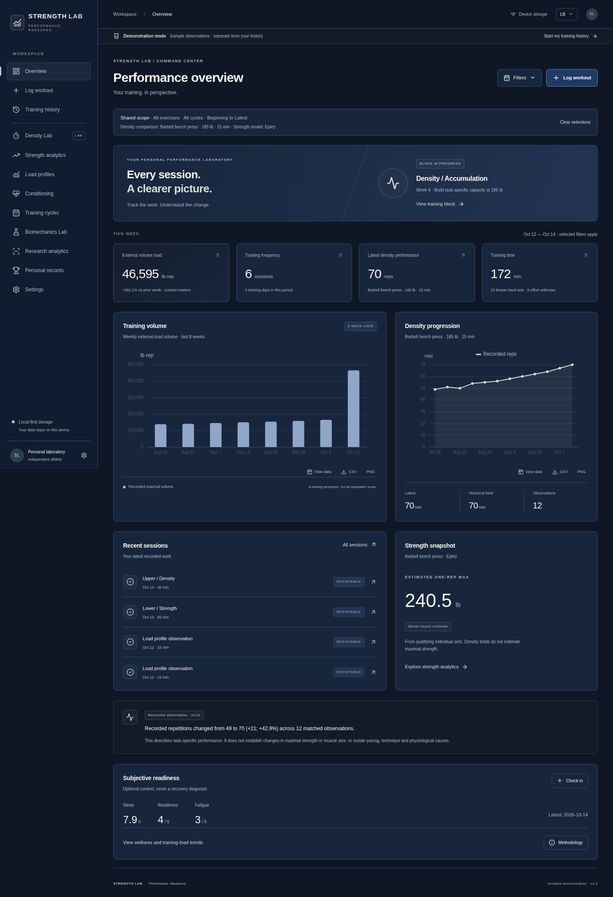

# Strength Lab

**Performance. Measured.** A local-first, installable strength and conditioning PWA. This is a standalone application under `strength-lab/` in the `dementions-of-health` repository; the existing Top Tier application remains intact.



## Run

Node 22+ recommended.

```sh
cd strength-lab
npm ci
npm run dev
```

```sh
npm test
npm run build
npm run test:e2e
```

Browser tests use system Chromium when `/usr/bin/chromium` exists; elsewhere run `npx playwright install chromium`. Tests start the production preview server automatically.

## Features

- Twelve desktop destinations and mobile navigation; dark/light themes; SI persistence with lb/kg presentation.
- Shared exercise, cycle, date-range, density protocol and strength-formula selection across analytics, with a visible scope summary and reload persistence. Historical date ranges drive overview period totals. Exercise edits update their protocol and auto-generated session labels together.
- Quick 15-minute density entry; detailed sets, grouped supersets/clusters/circuits, isometric hold duration, effort, timestamps and movement observations.
- Multiple exercise observations per session; persistent drafts, editing and confirmed deletion.
- Strict fixed-load/window comparisons; separate variable-load/time views; rolling means, accumulation data only when recorded.
- Cycle load profiles, scatterplots, improvement heatmaps and historical/current intensity contexts; editable intensity zones.
- Individual-set Epley/Brzycki estimates, explicitly declared maximum tests, formula-specific and protocol-specific records.
- Training cycles, density targets, explicit completion links, adherence and unequal-cycle comparisons.
- Activity-specific conditioning, interval breakdowns, elapsed pace/speed and fixed-distance records.
- Optional wellness check-ins and subjective session-RPE load calculation.
- Explicit vertical mechanics calculator; optional acceleration and applied-force estimates.
- Exploratory elapsed-date regression, rolling mean/median, variability and same-date readiness correlations.
- IndexedDB/Dexie, offline production cache, transactional JSON backup/import, corruption checks and duplicate/conflict handling; CSV/chart PNG exports.
- Clearly labeled demonstration database, separate from personal history.

The initial screen uses demonstration data. Choose **Start my training history** to enter the empty personal database. The active environment remains clearly labeled.

## Data and scientific boundaries

No server, account, analytics telemetry, cloud synchronization or external AI calls. Records are stored in this browser. Clearing browser data may remove them; export a full JSON backup regularly. Backups are plaintext. CSV does not restore the database.

Summary and individual-set totals are mutually exclusive. Density totals never enter 1RM equations. Missing inputs remain missing. Bodyweight, assistance and machine-stack volume are omitted when a suitable resistance model is unavailable. Added-load calisthenics volume represents added load only. A heaviest training single is distinct from a declared tested maximum.

The biomechanics calculator does not write observations. It uses entered/measured displacement and time under a simplified vertical model. No muscle force, peak power, instantaneous velocity, hypertrophy, recovery diagnosis, injury prediction or causal adaptation claims are made.

Confidence intervals, dependence-aware inference, encrypted backups, sensor integrations and cloud synchronization are deferred. Research sources have verified bibliographic metadata; full-text methodological review and the primary historical Epley source still require verification before empirical accuracy claims can be published. Basic formulas and all current input domains have automated tests.

## GitHub Pages

The app supports repository subpaths and hash routes. Build for this repository:

```sh
VITE_BASE_PATH=/dementions-of-health/ npm run build
```

A prepared `strength-lab-pages` branch contains the production site. A repository owner can enable it at **Settings → Pages → Deploy from a branch → strength-lab-pages → / (root)**. The expected URL is `https://knutetimothybrewer-lab.github.io/dementions-of-health/` after GitHub confirms deployment. This URL is not a verified deployment until Pages is enabled and its build succeeds.

The optional workflow in `deployment/strength-lab-pages.yml` can be copied to the repository's `.github/workflows/` by an account with workflow permissions. For Actions deployment, select **GitHub Actions** as the Pages source. It tests and builds the standalone subproject.

Do not change the hosted origin without exporting your browser database first; IndexedDB is origin-specific. Browser install support differs across devices. Chromium desktop/mobile emulation and offline reload are automated; actual iOS/Android installation still needs device verification.

## Architecture

`src/domain` contains pure calculations, Zod schemas and comparison rules. `src/data` contains normalized repositories, integrity checks and isolated sample fixtures. `src/pages` contains feature screens. `src/components` contains shared accessible controls, methodology and lazy-loaded charts. A versioned backup format excludes derived results and transient drafts.

The first DB schema is version 1. Future structural migrations require old-schema fixtures and an explicit version increment. Formula changes should rebuild derived results rather than rewrite observations.
